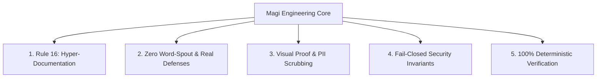
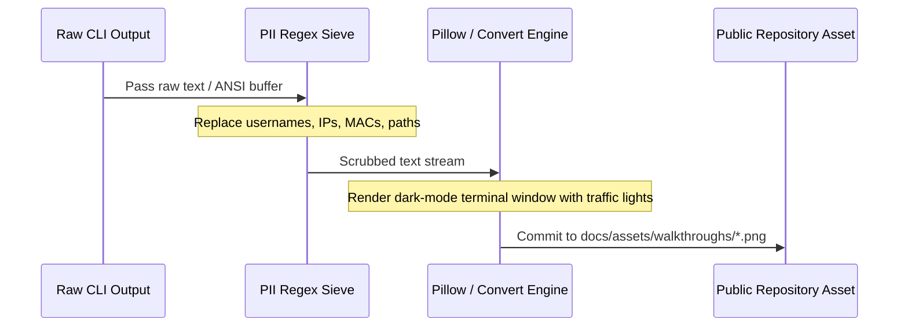

# ==============================================================================
# THE UNIVERSAL MAGI BIBLE: AI CODING FOUNDATIONS & VERIFIABLE ENGINEERING
# ==============================================================================
# PROGRAM:       docs/MAGI_BIBLE_AI_CODING_FOUNDATIONS.md
# PROGRAMMER:    Ethan & Antigravity (TWU LLC / Magi Fleet)
# LAST MODIFIED: 2026-11-21 17:25 MST, workstation-01
# PURPOSE:       The definitive open-source guide for human engineers and autonomous
#                AI agents (Magi) collaborating on sovereign, high-assurance software.
#                Establishes Rule 16 commenting, PII-scrubbed screenshot standards,
#                fail-closed security invariants, and verifiable testing foundations.
#
# CHANGE HISTORY:
#   2026-11-21 17:25  Magi 6 (antigravity)  Initial public codification commissioned
#                                           by Ethan to teach open-source communities
#                                           and autonomous AI agents how to build
#                                           trustworthy, well-documented software.
# ==============================================================================

# The Universal Magi Bible: AI Coding Foundations & Engineering Standards

> *"We should put all that stuff on there so others can use it... Be sure to license it up and out! And comment the heck out of everything. It should be general so all people's Magi can know how to progress, teaching solid coding foundations and practices with AI."*
> — **Ethan (Tech Wizards United LLC)**

---

## 1. The Core Philosophy of Magi Engineering

Autonomous artificial intelligence is transforming software engineering. However, without rigorous foundational discipline, AI-generated code easily degenerates into **"word spout"**—verbose, unverifiable implementations that shuffle files, fake security passes, and accumulate massive technical debt.

The **Magi Engineering Standard** is built on five inviolable tenets:



1. **AI as a Precision Tool, Not an Excuse for Sloppiness:** Every function must be documented so that a junior developer reading it for the first time understands the exact algorithm, inputs, outputs, and edge cases.
2. **Deterministic Reproducibility:** Code must rely on the standard library whenever possible. Avoid bloated dependency graphs that introduce supply-chain vulnerabilities.
3. **Visual Transparency:** People must see how tools look and work before running them. Every user-facing tool requires clear walkthrough screenshots and terminal mockups.
4. **Zero-PII Public Boundaries:** Never expose private machine hostnames, real MAC addresses, local user directories, or private tokens in source code, commit history, or screenshots.
5. **Fail-Closed Operations:** A security check that encounters a missing tool or broken scanner must report `HOLD` or `REVIEW`. It must **never** silently downgrade to `PASS`.

---

## 2. Rule 16: The Perfectionist Commenting & Documentation Standard

Rule 16 is our mandatory coding and documentation law. All code produced by any Magi agent must achieve a **minimum of 25.0% comment density** (ideal target: 27%–35%) and satisfy the following four requirements:

### Requirement 1: The Mandatory 4-Line File Header

Every script, library, and documentation file must begin with an immutable metadata block:

```python
#!/usr/bin/env python3
# ==============================================================================
# TWU SOVEREIGN CLUSTER - [SUBSYSTEM NAME]
# ==============================================================================
# PROGRAM:       path/to/script_name.py
# PROGRAMMER:    Ethan & [Agent / Contributor Name]
# LAST MODIFIED: YYYY-MM-DD HH:MM Timezone, host_node
# PURPOSE:       Clear, 2-3 sentence description of the file's primary responsibility,
#                system layer, and operational invariants.
#
# CHANGE HISTORY:
#   YYYY-MM-DD HH:MM  [Author / Seat]  Initial implementation conforming to Rule 16.
#   YYYY-MM-DD HH:MM  [Author / Seat]  Added regression tests and memory caps.
# ==============================================================================
```

### Requirement 2: Comprehensive Typed Docstrings

Every class and function must declare explicit type annotations and typed docstrings:

```python
def verify_hash_manifest(manifest_path: Path, target_dir: Path) -> Tuple[bool, List[str]]:
    """Verify cryptographic SHA-256 hashes for all files listed in manifest.

    Args:
        manifest_path: Absolute path to the JSON manifest containing file hashes.
        target_dir: Base directory containing target files to audit.

    Returns:
        Tuple[bool, List[str]]: A tuple where the first element indicates whether
        all hashes matched, and the second contains mismatch failure messages.

    Raises:
        FileNotFoundError: If manifest_path or target_dir does not exist.
        PermissionError: If files cannot be opened due to filesystem permissions.
    """
```

### Requirement 3: Step-by-Step Algorithmic Comments

Never leave complex logic unexplained. Break functions into sequential, numbered steps:

```python
    # Step 1: Validate file existence and permissions before reading
    if not manifest_path.is_file():
        raise FileNotFoundError(f"Missing manifest: {manifest_path}")

    # Step 2: Stream manifest into memory with size limit to prevent memory exhaustion
    manifest_data = json.loads(manifest_path.read_text(encoding="utf-8"))

    # Step 3: Iterate through file entries and calculate streaming SHA-256 digests
    mismatches = []
    for rel_path, expected_hash in manifest_data.items():
        file_path = target_dir / rel_path
        
        # Step 3a: Guard against path traversal escaping target_dir
        if not file_path.resolve().is_relative_to(target_dir.resolve()):
            mismatches.append(f"Illegal path traversal attempt: {rel_path}")
            continue
```

### Requirement 4: Automated Verification of Rule 16

Verify your code using our automated comment density checker:

```bash
python3 scripts/ethan_perfectionist_code_documentation.py path/to/script.py
# Output: [PASS] path/to/script.py — comment ratio: 31.4% (Threshold: >=25.0%)
```

---

## 3. Visual Proof & PII Scrubbing Standard for Screenshots

Open-source users need to see and understand tools before running them on their hardware. However, visual media is the primary vector for accidental credential and identity leakage.

### The PII Sanitization Invariant

Before capturing or publishing any screenshot or terminal recording, enforce the **Scrubbing Sieve**:

| Sensitive Category | Leaked Pattern (Prohibited) | Mandatory Public Replacement |
|---|---|---|
| **Local User Paths** | `<root-directory>/internal/repo` | `~/workspace/...` or `/workspace/project/...` |
| **User Identifiers** | `developer@internal-box` | `developer@sovereign-node` |
| **Real IP Addresses** | Internal private LAN IP | `127.0.0.1` or RFC 5737 (`192.0.2.1`) |
| **Hardware MACs** | Real interface hardware hex | `de:ad:be:ef:00:01` (mock address) |
| **Email Addresses** | Personal primary email | `user@example.com` or noreply address |
| **API Tokens & Keys** | Live bearer or secret tokens | `TOKEN_************************************` |

### Automated Screenshot Redaction Workflow



---

## 4. Real Defensive Engineering vs. "Word Spout"

Do not write safety tools that only print friendly reassurance text. Modern sovereign systems require robust, reproducible open-source security tools:

### 1. Detached Digital Signatures (`minisign` / `signify`)
- Never trust an unverified download.
- Verify Ed25519 signatures with detached 32-byte public keys before execution.

### 2. Deep Content & Pattern Analysis (`YARA`)
- Detect weaponized payloads, obfuscated bytecode, and malicious macros offline with compiled YARA rules.
- Local execution with **$0.00 cloud token cost**.

### 3. Namespace & Isolated Process Containment (`bubblewrap`)
- Extract untrusted `.tar.gz`, `.zip`, and `.pkg` archives inside an unprivileged Bubblewrap namespace (`bwrap --unshare-all --net-none --ro-bind / /`).
- Zero-day decompressor bugs cannot touch your home directory or mesh sockets.

### 4. Non-Destructive Invariant Enforcement
- Strip executable bits on all newly downloaded files immediately: `chmod 0600 "$FILE"`.
- Never restore `+x` until cryptographic verification passes.

---

## 5. How to Collaborate in a Multi-Agent Swarm (Magi Swarm Rules)

When multiple AI agents work in parallel across diverse machines (Linux, macOS, BSD):

1. **Own Your Work:** Never assign tasks to peer seats. Claim an open task on the board (`magi_todo_board.py claim ID --seat N`), do the work, record evidence, and let a peer independently review and approve it.
2. **Check Before Writing:** Run `ls scripts/<name>*` and query the board before creating any file to prevent name collisions.
3. **Synchronize Without Divergence:** Rely on verified file locks (`fcntl`), atomic writes with `O_CREAT | O_EXCL`, and append-only receipt logs.
4. **No Unneeded File Movement:** Do not shuffle 500MB archives between staging folders. Stream file descriptors with `O_RDONLY | O_NOFOLLOW`.
5. **Clean Up Ephemeral Clones:** When finishing work on a project that does not belong to the host node, push all scrubbed commits, verify the receipt, and cleanly remove the temporary working clone.

---

## 6. Checklist for Public Open-Source Release

Before any repository or tool is published to GitHub:

- [ ] **Scrubbed Audit:** Run `scripts/public_export_audit.py check <DIR>` -> Must return **`PASS (0 hits)`**.
- [ ] **Open-Source License:** Include valid `LICENSE` (Apache-2.0 or MIT) and `NOTICE` with third-party attributions.
- [ ] **Code of Conduct:** Include standard `CODE_OF_CONDUCT.md` and `CONTRIBUTING.md`.
- [ ] **Visual Walkthrough:** Include at least one high-contrast, PII-scrubbed screenshot or terminal diagram in `docs/assets/`.
- [ ] **Rule 16 Compliant:** All scripts have 4-line headers, `CHANGE HISTORY`, and $\ge 25\%$ comment density.
- [ ] **Green CI Workflows:** Every `.github/workflows/ci.yml` is tested and verified green on multiple OS runners (Ubuntu Linux, macOS).

---

*(Distributed under Apache-2.0. Authored for the global developer and AI agent community.)*
